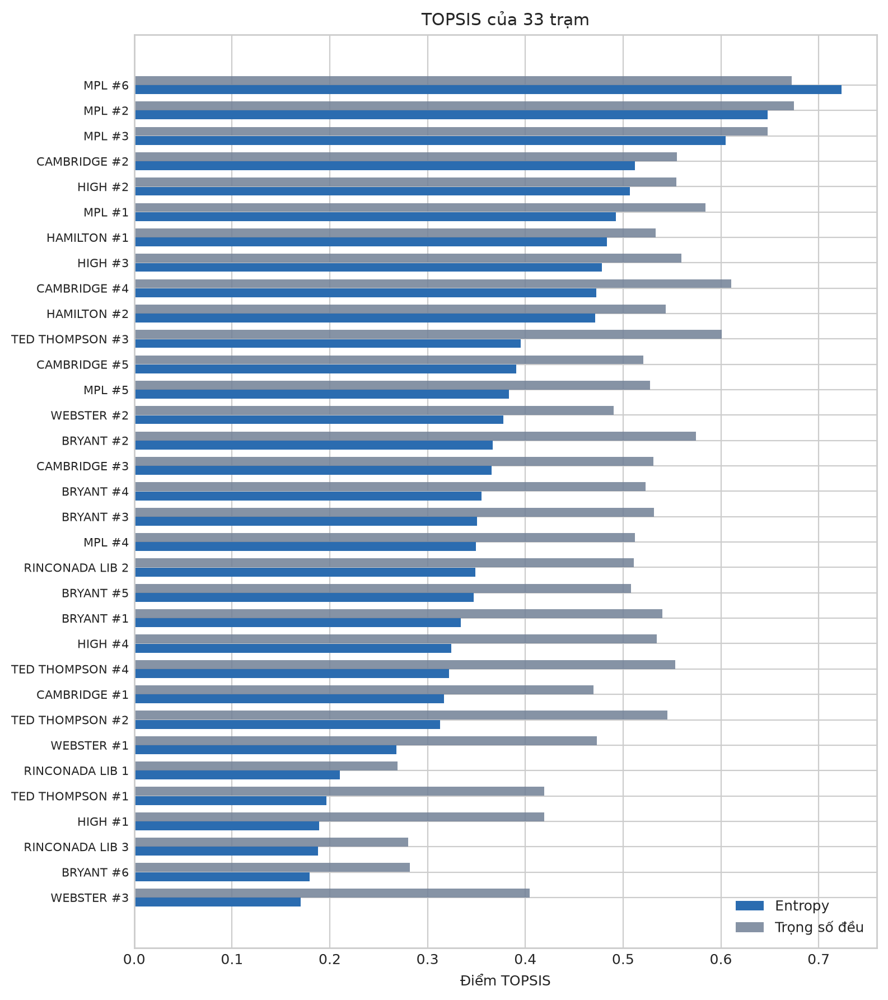
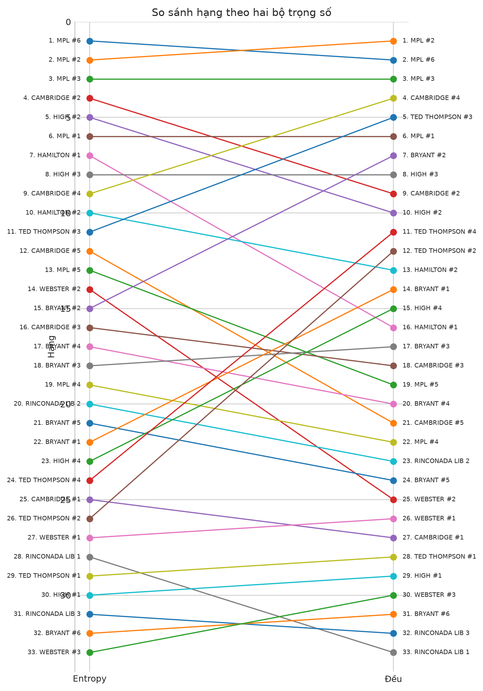
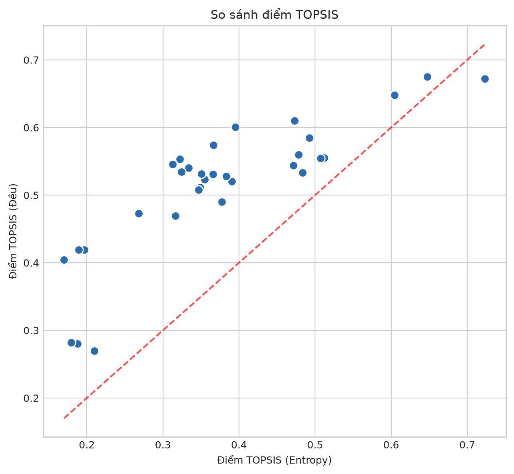
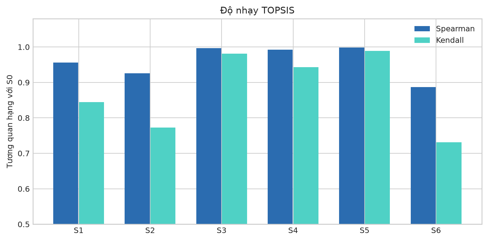

# 3.4.3. Quy trình xếp hạng đa tiêu chí TOPSIS (Technique for Order Preference by Similarity to Ideal Solution)

### a) Mục tiêu và cơ sở lựa chọn TOPSIS

Sau khi xây dựng thành công ma trận 6 tiêu chí hiệu suất vận hành $\mathbf{X} \in \mathbb{R}^{33 \times 6}$ và xác định hai bộ trọng số đối sánh (Trọng số Entropy khách quan và Trọng số đều đối chứng), bài toán đặt ra là cần một công cụ toán học hỗ trợ ra quyết định đa tiêu chí (*Multi-Criteria Decision Making - MCDM*) nhằm tổng hợp các chỉ báo đa chiều thành một thước đo hiệu suất tương đối duy nhất, cho phép xếp hạng thứ bậc toàn diện 33 trạm sạc trong mạng lưới thành phố Palo Alto.

Nghiên cứu lựa chọn kỹ thuật **TOPSIS (*Technique for Order Preference by Similarity to Ideal Solution*)** — do Hwang & Yoon (1981) đề xuất — dựa trên các cơ sở phương pháp luận sau:
1. **Nguyên lý hình học trực quan và chặt chẽ:** TOPSIS vận hành trên nguyên tắc phương án tối ưu phải đồng thời thỏa mãn hai điều kiện hình học trong không gian đa chiều: có khoảng cách Euclid ngắn nhất tới **Nghiệm lý tưởng dương (*Positive Ideal Solution - PIS*)** và có khoảng cách xa nhất tới **Nghiệm lý tưởng âm (*Negative Ideal Solution - NIS*)**.
2. **Bảo toàn toàn bộ thông tin gốc:** Khác với các phương pháp loại trừ thứ bậc (*outranking methods* như ELECTRE, PROMETHEE) đòi hỏi thiết lập các ngưỡng không phân biệt phức tạp, TOPSIS tận dụng trực tiếp giá trị định lượng liên tục của ma trận dữ liệu mà không làm thất thoát thông tin phương sai.
3. **Tương thích hoàn hảo với ma trận chuẩn hóa Min-Max:** Khi áp dụng trên ma trận đã chuẩn hóa định hướng lợi ích $R$, TOPSIS không yêu cầu thêm bất kỳ phép nghịch đảo thứ cấp nào, loại bỏ hoàn toàn rủi ro đảo ngược thứ hạng do chuyển đổi tỷ lệ phi tuyến.

---

### b) Xây dựng ma trận quyết định chuẩn hóa có trọng số

Kế thừa trực tiếp ma trận quyết định chuẩn hóa theo hướng lợi ích $R = [R_{ij}]_{33 \times 6}$ từ Mục 3.4.2 (trong đó mọi tiêu chí đều đã được đưa về thang đo $[0, 1]$ với $1$ là mức hiệu suất tốt nhất và $0$ là mức kém nhất), ma trận quyết định chuẩn hóa có trọng số $V = [V_{ij}]_{33 \times 6}$ được xác định bằng phép nhân từng phần tử giữa cột tiêu chí với trọng số tương ứng $w_j$:

$$V_{ij} = w_j \times R_{ij}, \quad \forall i = 1, \dots, 33; \quad j = 1, \dots, 6$$

Trong đó:
- $w_j \ge 0$ và $\sum_{j=1}^6 w_j = 1$.
- Nghiên cứu triển khai song song hai ma trận: $V_{\text{entropy}}$ (sử dụng vector trọng số Entropy $\mathbf{w}_{\text{entropy}}$) và $V_{\text{equal}}$ (sử dụng vector trọng số đều $\mathbf{w}_{\text{equal}} = [1/6, \dots, 1/6]^T$).

---

### c) Xác định nghiệm lý tưởng dương và nghiệm lý tưởng âm

Do toàn bộ 6 tiêu chí trong ma trận $R$ đã được đồng nhất hóa thành các chỉ báo dạng lợi ích (*benefit indicators*), nghiệm lý tưởng dương $A^+$ đại diện cho một "trạm sạc giả định hoàn hảo" đạt giá trị cực đại trên mọi chiều tiêu chí; ngược lại, nghiệm lý tưởng âm $A^-$ đại diện cho một "trạm sạc giả định kém nhất" đạt giá trị cực tiểu trên mọi chiều:

$$A^+ = [A_1^+, A_2^+, \dots, A_6^+] \quad \text{với} \quad A_j^+ = \max_{i=1,\dots,33} V_{ij}$$

$$A^- = [A_1^-, A_2^-, \dots, A_6^-] \quad \text{với} \quad A_j^- = \min_{i=1,\dots,33} V_{ij}$$

*Lưu ý phương pháp luận:* Vì ma trận $R$ đã đảo chiều các tiêu chí chi phí $C_5, C_6$ ở bước chuẩn hóa Min-Max, tại bước này tuyệt đối không thực hiện đảo ngược chiều một lần nữa nhằm tránh làm méo mó cấu trúc không gian nghiệm.

---

### d) Tính khoảng cách đến các nghiệm lý tưởng

Khoảng cách phân tách hình học từ trạm sạc thứ $i$ ($i = 1, \dots, 33$) đến nghiệm lý tưởng dương ($D_i^+$) và nghiệm lý tưởng âm ($D_i^-$) được đo lường bằng hàm khoảng cách Euclid trong không gian $\mathbb{R}^6$:

$$D_i^+ = \sqrt{\sum_{j=1}^6 \left(V_{ij} - A_j^+\right)^2}$$

$$D_i^- = \sqrt{\sum_{j=1}^6 \left(V_{ij} - A_j^-\right)^2}$$

---

### đ) Xác định hệ số gần lý tưởng và thứ hạng trạm sạc

Hệ số gần nghiệm lý tưởng tương đối (*Closeness Coefficient - $CC_i$*) của trạm sạc thứ $i$ được tính bằng tỷ số giữa khoảng cách tới nghiệm âm và tổng khoảng cách tới cả hai nghiệm:

$$CC_i = \frac{D_i^-}{D_i^+ + D_i^-}, \quad CC_i \in [0, 1]$$

*Nguyên tắc xếp hạng và diễn giải bản chất:*
- $CC_i \to 1$: Trạm sạc có cấu hình hiệu suất tiệm cận nghiệm lý tưởng dương và cách xa nghiệm âm.
- $CC_i \to 0$: Trạm sạc tiệm cận nghiệm lý tưởng âm.
- **Lưu ý cốt lõi:** Điểm số $CC_i$ là một **thước đo xếp hạng đa tiêu chí tương đối nội bộ mạng lưới**, tuyệt đối không phải là tỷ lệ phần trăm hiệu suất vận hành tuyệt đối hay hiệu suất sử dụng cổng sạc vật lý.
- Thứ hạng chính thức được xác định bằng cách sắp xếp 33 trạm sạc theo thứ tự $CC_i$ giảm dần (áp dụng quy tắc giải quyết đồng hạng xác định `method="min"`).

---

### e) Kết quả xếp hạng theo Entropy và Equal Weighting

Áp dụng quy trình tính toán trên toàn bộ 33 trạm sạc hợp lệ của thành phố Palo Alto, thu được bảng kết quả xếp hạng tổng hợp đối sánh giữa Trọng số Entropy và Trọng số đều:

**Bảng 3.7. Bảng xếp hạng hiệu suất TOPSIS hoàn chỉnh cho 33 trạm sạc Palo Alto**

| STT | Tên trạm sạc | Số phiên sạc ($C_1$) | Điểm TOPSIS (Entropy) | Hạng Entropy | Điểm TOPSIS (Trọng số đều) | Hạng Đều | Độ lệch thứ hạng ($|\Delta \text{Rank}|$) |
| :---: | :--- | :---: | :---: | :---: | :---: | :---: | :---: |
| 1 | PALO ALTO CA / HAMILTON #2 | 23.666 | **0,7228** | **1** | 0,6721 | 2 | 1 |
| 2 | PALO ALTO CA / WEBSTER #1 | 14.394 | **0,6470** | **2** | **0,6739** | **1** | 1 |
| 3 | PALO ALTO CA / WEBSTER #2 | 12.644 | 0,6045 | 3 | 0,6476 | 3 | 0 |
| 4 | PALO ALTO CA / HAMILTON #1 | 14.825 | 0,5119 | 4 | 0,5548 | 9 | 5 |
| 5 | PALO ALTO CA / HIGH #4 | 13.836 | 0,5069 | 5 | 0,5545 | 10 | 5 |
| 6 | PALO ALTO CA / WEBSTER #3 | 10.458 | 0,4926 | 6 | 0,5843 | 6 | 0 |
| 7 | PALO ALTO CA / BRYANT #2 | 14.289 | 0,4834 | 7 | 0,5328 | 16 | **9** |
| 8 | PALO ALTO CA / HIGH #1 | 10.738 | 0,4787 | 8 | 0,5597 | 8 | 0 |
| 9 | PALO ALTO CA / TED THOMPSON #1 | 9.798 | 0,4731 | 9 | 0,6102 | 4 | 5 |
| 10 | PALO ALTO CA / BRYANT #1 | 13.402 | 0,4714 | 10 | 0,5432 | 13 | 3 |
| 11 | PALO ALTO CA / TED THOMPSON #2 | 2.217 | 0,3961 | 11 | **0,6006** | **5** | **6** |
| 12 | PALO ALTO CA / MPL #6 | 8.970 | 0,3905 | 12 | 0,5204 | 21 | **9** |
| 13 | PALO ALTO CA / HIGH #3 | 8.306 | 0,3836 | 13 | 0,5276 | 19 | 6 |
| 14 | PALO ALTO CA / CAMBRIDGE #1 | 11.148 | 0,3776 | 14 | 0,4900 | 25 | **11** |
| 15 | PALO ALTO CA / BRYANT #4 | 3.594 | 0,3072 | 15 | 0,5743 | 7 | **8** |
| 16 | PALO ALTO CA / RINCONADA LIB 1 | 6.203 | 0,3060 | 16 | 0,5309 | 18 | 2 |
| 17 | PALO ALTO CA / RINCONADA LIB 3 | 6.489 | 0,3557 | 17 | 0,5230 | 20 | 3 |
| 18 | PALO ALTO CA / RINCONADA LIB 2 | 5.541 | 0,3509 | 18 | 0,5310 | 17 | 1 |
| 19 | PALO ALTO CA / MPL #4 | 7.757 | 0,3495 | 19 | 0,5111 | 23 | 4 |
| 20 | PALO ALTO CA / HIGH #2 | 6.917 | 0,3495 | 20 | 0,5115 | 22 | 2 |
| 21 | PALO ALTO CA / MPL #5 | 7.520 | 0,3472 | 21 | 0,5080 | 24 | 3 |
| 22 | PALO ALTO CA / BRYANT #6 | 5.847 | 0,3347 | 22 | 0,5402 | 14 | **8** |
| 23 | PALO ALTO CA / BRYANT #5 | 5.313 | 0,3251 | 23 | 0,5342 | 15 | **8** |
| 24 | PALO ALTO CA / TED THOMPSON #3 | 2.451 | 0,3229 | 24 | 0,5533 | 11 | **13** |
| 25 | PALO ALTO CA / CAMBRIDGE #2 | 9.237 | 0,3167 | 25 | 0,4690 | 27 | 2 |
| 26 | PALO ALTO CA / TED THOMPSON #4 | 2.221 | 0,3136 | 26 | 0,5454 | 12 | **14** |
| 27 | PALO ALTO CA / BRYANT #3 | 4.463 | 0,2685 | 27 | 0,4729 | 26 | 1 |
| 28 | PALO ALTO CA / MPL #2 | 1.528 | 0,2102 | 28 | **0,2692** | **33** | 5 |
| 29 | PALO ALTO CA / CAMBRIDGE #5 | 4.550 | 0,1968 | 29 | 0,4189 | 29 | 0 |
| 30 | PALO ALTO CA / CAMBRIDGE #3 | 4.472 | 0,1900 | 30 | 0,4192 | 28 | 2 |
| 31 | PALO ALTO CA / MPL #1 | 1.043 | 0,1885 | 31 | 0,2796 | 32 | 1 |
| 32 | PALO ALTO CA / MPL #3 | 1.418 | 0,1797 | 32 | 0,2810 | 31 | 1 |
| 33 | PALO ALTO CA / CAMBRIDGE #4 | 3.426 | **0,1710** | **33** | 0,4041 | 30 | 3 |

**Bảng 3.8. Đối chiếu nhóm dẫn đầu (Top 5) và nhóm cuối bảng (Bottom 5)**

| Phân nhóm | Xếp hạng theo Trọng số Entropy | Xếp hạng theo Trọng số đều (Equal Weighting) |
| :--- | :--- | :--- |
| **Top 1** | **HAMILTON #2** ($CC = 0,7228$) | **WEBSTER #1** ($CC = 0,6739$) |
| **Top 2** | **WEBSTER #1** ($CC = 0,6470$) | **HAMILTON #2** ($CC = 0,6721$) |
| **Top 3** | **WEBSTER #2** ($CC = 0,6045$) | **WEBSTER #2** ($CC = 0,6476$) |
| **Top 4** | **HAMILTON #1** ($CC = 0,5119$) | **TED THOMPSON #1** ($CC = 0,6102$) |
| **Top 5** | **HIGH #4** ($CC = 0,5069$) | **TED THOMPSON #2** ($CC = 0,6006$) |
| *Bottom 29* | CAMBRIDGE #5 ($CC = 0,1968$) | CAMBRIDGE #5 ($CC = 0,4189$) |
| *Bottom 30* | CAMBRIDGE #3 ($CC = 0,1900$) | CAMBRIDGE #4 ($CC = 0,4041$) |
| *Bottom 31* | MPL #1 ($CC = 0,1885$) | MPL #3 ($CC = 0,2810$) |
| *Bottom 32* | MPL #3 ($CC = 0,1797$) | MPL #1 ($CC = 0,2796$) |
| *Bottom 33* | **CAMBRIDGE #4** ($CC = 0,1710$) | **MPL #2** ($CC = 0,2692$) |

*Hình 3.7. Điểm số TOPSIS của 33 trạm sạc dưới hai phương pháp gán trọng số (sắp xếp tăng dần theo điểm số Entropy).*

*Hình 3.8. Sơ đồ dịch chuyển thứ hạng (Slope Chart) của 33 trạm sạc giữa Trọng số Entropy và Trọng số đều.*

*Hình 3.9. Tương quan điểm số TOPSIS giữa Trọng số Entropy và Trọng số đều cùng các trạm sạc nhạy cảm điển hình.*

*Diễn giải các dịch chuyển thứ hạng đáng chú ý:*
1. **Sự ổn định ở nhóm xuất sắc nhất:** Ba trạm `HAMILTON #2`, `WEBSTER #1`, và `WEBSTER #2` chiếm lĩnh tuyệt đối Top 3 trong cả hai phương pháp. `HAMILTON #2` dẫn đầu về quy mô giao dịch ($23.666$ phiên, $191.136$ kWh), trong khi `WEBSTER #1` đạt chất lượng phiên sạc rất cao ($9,63$ kWh/phiên, thời gian sạc hữu ích $2,15$ giờ) kết hợp với tỷ lệ chiếm dụng thấp.
2. **Cụm trạm Ted Thompson hưởng lợi mạnh dưới Trọng số đều:**
   - `TED THOMPSON #4`: Dịch chuyển thăng hạng tới **14 bậc** (từ hạng 26 ở Entropy vọt lên hạng 12 ở Trọng số đều).
   - `TED THOMPSON #3`: Thăng hạng **13 bậc** (từ hạng 24 lên hạng 11).
   - `TED THOMPSON #2`: Thăng hạng **6 bậc** (từ hạng 11 lên vị trí Top 5).  
   *Nguyên nhân:* Cụm trạm Ted Thompson có lưu lượng khiêm tốn ($2.200 - 2.400$ phiên sạc), khiến điểm số Entropy bị kéo giảm mạnh do hai biến $C_1, C_2$ chiếm $57,1\%$ trọng số. Tuy nhiên, ở cấp độ từng phiên sạc, trạm này vận hành cực kỳ chuẩn mực: điện năng bình quân cao ($11,19$ kWh/phiên), tỷ lệ nhàn rỗi rất thấp ($8,01\%$) và chỉ có $2,35\%$ phiên chiếm dụng nặng. Khi chuyển sang Trọng số đều, giá trị vận hành chất lượng này được phản ánh xứng đáng.
3. **Cụm trạm Cambridge sụt giảm thứ bậc dưới Trọng số đều:**
   - `CAMBRIDGE #1`: Bị tụt lùi **11 bậc** (từ hạng 14 ở Entropy xuống hạng 25 ở Trọng số đều).  
   *Nguyên nhân:* Trạm có lượng giao dịch lớn ($11.148$ phiên sạc), tạo lợi thế ảo trong mô hình Entropy. Khi san bằng trọng số, nhược điểm về hiệu suất tiêu thụ thấp ($7,21$ kWh/phiên) và tỷ lệ chiếm dụng nhàn rỗi cao khiến trạm rơi sâu xuống nửa dưới bảng xếp hạng.

---

### g) Phân tích độ ổn định và độ nhạy của kết quả

#### 1. Mức độ đồng thuận giữa hai mô hình cơ sở (S0)
- **Hệ số tương quan hạng Spearman:** Đạt **$\rho = 0,8192$** ($p < 0,001$).
- **Hệ số tương quan Kendall Tau:** Đạt **$\tau = 0,6364$** ($p < 0,001$).
- **Độ trùng khớp Top 5:** Đạt $3/5$ trạm ($60\%$).
- **Độ lệch thứ hạng tuyệt đối bình quân:** $4,30$ bậc; độ lệch lớn nhất là $14$ bậc.
- **Tỷ lệ trạm có độ lệch $\ge 5$ bậc:** $14 / 33$ trạm ($42,4\%$).

*Luận chứng phương pháp:* Mặc dù hệ số Spearman $\rho = 0,8192$ thể hiện sự tương quan thứ bậc thuận ở mức cao, việc có tới hơn $42\%$ số trạm thay đổi từ 5 bậc trở lên cho thấy **quyết định gán trọng số có tác động chi phối mạnh mẽ đến thứ hạng cụ thể của từng trạm**.

#### 2. Kết quả kiểm định độ nhạy qua 6 kịch bản (S1–S6)

Để kiểm chứng tính bền vững của mô hình và xác định rõ ảnh hưởng của các giả định phương pháp luận, 6 kịch bản nhạy cảm đã được thiết lập và tính toán lại toàn bộ trọng số cùng điểm số TOPSIS:

**Bảng 3.9. Kết quả đánh giá độ nhạy thứ hạng TOPSIS so với mô hình cơ sở S0**

| Kịch bản kiểm định | Cấu hình tiêu chí / Phương pháp | Số tiêu chí | Spearman $\rho$ (Entropy) | Kendall $\tau$ (Entropy) | Sai lệch thứ hạng TB | Sai lệch thứ hạng Max | Số trạm lệch $\ge 5$ bậc | Trùng khớp Top 5 |
| :--- | :--- | :---: | :---: | :---: | :---: | :---: | :---: | :---: |
| **S0: Cơ sở** | Đầy đủ $C_1 - C_6$ (Min-Max TOPSIS) | 6 | 1,0000 | 1,0000 | 0,00 | 0 | 0 | 5/5 |
| **S1: Loại $C_2$** | Loại Tổng điện năng ($C_2 = C_1 \times C_3$) | 5 | 0,9545 | 0,8409 | 2,00 | 8 | 4 | 4/5 |
| **S2: Loại $C_1$** | Loại Số phiên sạc ($C_1$) | 5 | 0,9228 | 0,7652 | 2,97 | 11 | 9 | 3/5 |
| **S3: Loại $C_6$** | Loại Chiếm dụng nghiêm trọng ($C_6$) | 5 | **0,9970** | **0,9773** | **0,30** | **2** | **0** | **5/5** |
| **S4: Loại $C_4$** | Loại Thời gian sạc hữu ích ($C_4$) | 5 | **0,9920** | **0,9470** | **0,79** | **3** | **0** | **5/5** |
| **S5: $C_5$ trọng số** | Thay $C_5$ bằng $\sum T_{\text{idle}} / \sum T_{\text{total}}$ | 6 | **0,9987** | **0,9848** | **0,24** | **3** | **0** | **5/5** |
| **S6: Chuẩn hóa vector** | TOPSIS kinh điển chuẩn hóa vector | 6 | 0,8870 | 0,7348 | 3,09 | 16 | 5 | 5/5 |

*Hình 3.10. Hệ số tương quan thứ hạng Spearman và Kendall của các kịch bản kiểm định so với mô hình cơ sở S0 (Mô hình Entropy).*

*Phát hiện quan trọng từ phân tích độ nhạy:*
1. **Tính dư thừa thông tin giữa $C_5$ và $C_6$ (Kịch bản S3):** Loại bỏ $C_6$ tạo ra sự dịch chuyển thứ hạng gần như bằng không ($\rho = 0,9970$, độ lệch bình quân chỉ $0,30$ bậc, không trạm nào lệch quá 2 bậc). Điều này chứng minh $C_6$ mang thông tin trùng lặp cao với $C_5$ đúng như kết quả tương quan Pearson $r = 0,9853$.
2. **Ảnh hưởng hạn chế của tiêu chí $C_4$ (Kịch bản S4):** Khi loại bỏ thời gian sạc bình quân $C_4$, thứ hạng mô hình Entropy gần như không đổi ($\rho = 0,9920$, Top 5 giữ nguyên $100\%$). Điều này giải tỏa lo ngại về tính mơ hồ trong định hướng lợi ích của $C_4$.
3. **Tính bền vững của thước đo nhàn rỗi (Kịch bản S5):** Thay thế $C_5$ trung bình phiên bằng $C_{5,\text{weighted}}$ dựa trên tổng thời lượng cắm cáp cho tương quan thứ hạng lên tới $\rho = 0,9987$, khẳng định phương pháp đo lường hành vi nhàn rỗi ở cấp phiên sạc có tính đại diện xuất sắc cho tổn thất thời gian toàn mạng.
4. **Tác động của mối quan hệ đại số $C_1 - C_2 - C_3$ (Kịch bản S1 & S2):** Loại bỏ $C_1$ hoặc $C_2$ làm giảm tương quan xuống $0,92 - 0,95$ và làm dịch chuyển một số trạm tầm trung. Điều này phản ánh thực tế rằng việc đưa cả hai biến quy mô vào mô hình Entropy đã nhân đôi sức nặng của khía cạnh quy mô nhu cầu, tạo ra một sự thiên vị nhẹ có lợi cho các cụm trạm lớn.

---

### h) Hàm ý vận hành và giới hạn của kết quả xếp hạng

#### 1. Hàm ý quản trị vận hành trạm sạc (Actionable Insights)
Kết quả xếp hạng đa tiêu chí cung cấp cơ sở phân loại rõ nét để nhà điều hành hệ thống (*Charge Point Operator - CPO*) và chính quyền thành phố áp dụng các chính sách can thiệp có mục tiêu:
- **Nhóm trạm kiểu mẫu (Top-tier: Hamilton #2, Webster #1, Webster #2):** Đây là các tài sản hạ tầng chủ lực hoạt động với hiệu suất tối ưu cả về lưu lượng phục vụ lẫn kỷ luật giải phóng chỗ đỗ. Cần ưu tiên duy trì lịch bảo trì định kỳ, đảm bảo độ khả dụng kỹ thuật của thiết bị luôn ở mức cao nhất.
- **Nhóm trạm có hành vi phiên sạc chuẩn mực nhưng quy mô thấp (Ted Thompson #2, #3, #4):** Mặc dù số phiên còn thấp do vị trí địa lý hoặc đặc thù dân cư, người dùng tại đây tuân thủ thời gian đỗ rất tốt và nạp lượng điện lớn. CPO có thể xem xét các giải pháp biển báo dẫn đường hoặc truyền thông để định hướng thêm lưu lượng từ các khu vực quá tải lân cận sang các trạm này.
- **Nhóm trạm có lưu lượng lớn nhưng tắc nghẽn nhàn rỗi cao (Cambridge #1, Bryant #2):** Các trạm này có nhu cầu sạc tự nhiên rất cao nhưng đang bị suy giảm tính sẵn sàng do tình trạng xe sạc xong đỗ ngâm chiếm chỗ. **Khuyến nghị chính sách:** Đây là đối tượng ưu tiên hàng đầu để thiết lập hệ thống camera giám sát thông minh hoặc áp dụng mức phụ phí đỗ nhàn rỗi tăng lũy tiến sau khung giờ ân hạn.
- **Nhóm trạm cuối bảng (MPL #2, Cambridge #4):** Trạm `MPL #2` có tỷ lệ nhàn rỗi lên tới $24,2\%$ và $26,7\%$ số phiên chiếm dụng nặng, trong khi lưu lượng phục vụ rất thấp ($1.528$ phiên). Trạm `CAMBRIDGE #4` có điện năng và thời gian sạc hữu ích đều ở mức đáy mạng lưới. Đơn vị quản lý cần tiến hành khảo sát thực địa để làm rõ nguyên nhân (do quy định đỗ xe khu vực, thói quen của cơ quan lân cận hay sự cố giới hạn công suất cổng sạc).

#### 2. Giới hạn phương pháp luận của nghiên cứu
Để đảm bảo tính trung thực khoa học, các giới hạn nội tại của khung phân tích này cần được khẳng định rõ:
1. **Không đo lường hiệu suất sử dụng cổng sạc vật lý (*Port-level Utilization Rate*):** Do tập dữ liệu mở của thành phố Palo Alto không cung cấp số lượng cổng sạc vật lý (*port count*) của từng trạm, mô hình phân tích ở cấp độ định danh trạm (*Station Name*). Vì vậy, điểm số TOPSIS phản ánh hiệu suất tổng thể của điểm sạc chứ không đại diện cho tỷ lệ lấp đầy trên từng cổng sạc riêng lẻ.
2. **Không phản ánh hiệu quả tài chính và tỷ suất sinh lời (*Financial Return / ROI*):** Phân tích được giới hạn trong phạm vi dữ liệu vận hành giao dịch (năng lượng và thời gian), chưa tích hợp chi phí đầu tư ban đầu (*CAPEX*), chi phí bảo trì vận hành (*OPEX*), chi phí đất đai và doanh thu bán điện thực tế.
3. **Tính tương đối của điểm số TOPSIS:** Điểm số $CC_i$ phụ thuộc vào tập hợp 33 trạm sạc được đưa vào đánh giá. Nếu bổ sung thêm các trạm sạc mới hoặc thay đổi tập dữ liệu sang đô thị khác, điểm số và nghiệm lý tưởng sẽ dịch chuyển tương ứng. Do đó, kết quả xếp hạng phải được hiểu là thước đo so sánh đối chuẩn nội bộ (*internal relative benchmarking*) thay vì một tiêu chuẩn đánh giá tuyệt đối.

